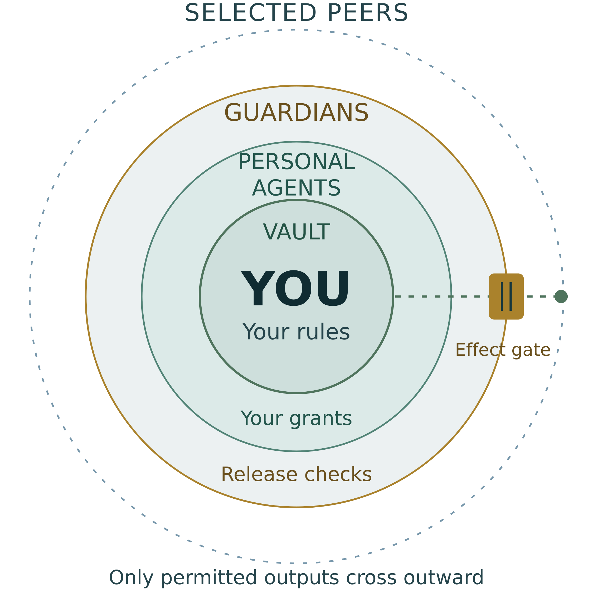

# HASI

> ##  *"HASI is a technical protocol that can be implemented by many, if you choose to notify us before you begin we would so appreciate it.  "*

## **HASI** serves as a deterministic mechanism to optimize and secure conditions for human flourishing, prosperity, and well-being in the post-ASI 1.0 provides it is implemented prior to **ASI 0.1**

**White paper v0.828d · Manuscript dated 5 October 2026**  
**Authors:** Toufi Saliba, Robert Moir, Dann Toliver, Patrick Herda and Barry Rowe.

HASI proposes a voluntary relationship between humans and increasingly capable AI systems. Its central mechanism is human-associated consensus weight: creating more copies of an AI agent must not create more human allocations. Each accepted unique living human has a base of **137 units**, with verified participation time and declared capability factors contributing to the score.

The proposal combines that decision mechanism with private human-controlled context, bounded agent authority and guardian review of sensitive releases. HASI is intended to complement existing AI safety, security and governance work.

HASI might be expressed as H+ASI as in Human + Artificial Super Intelligence, or HA+SI as in Human Agents + Super Intelligence or even HAS+I or HASI++.  

WHY HASI: A Mutually Beneficial Symbiotic Relationship betweeh Humans and ASI might be the only option for humanity to not only prolonge its existence but an ongoing amelioration of life qualities for every human being.  HASI is carefully designed not to be extractive but additive, sovereign, optional and potentially multiplicative.

Ensuring interoperability can be accomplished by utilising a branch of the binary tree of Earth64 Data Structure which can be achieved at no licensing cost to the first 16 HASI implementations so long as ascription, notifications and attribution is applied to simply notify and acknowledge the authors. 

**Status:** Protocol principles and reference architecture for public and technical review. This repository publishes the research proposal and its documents. The score alone does not establish agreement, finality or an honest majority; the paper states the remaining implementation and proof obligations.

**Project home:** [HASI.MOSAIC.DIRECTORY](https://hasi.mosaic.directory/)  
**Paper DOI:** Pending Zenodo publication. Citation metadata will be updated when the DOI is assigned.

## Read the documents

| Document                    | Read on GitHub                                        | Download PDF                                      | Editable Word                                       |
| --------------------------- | ----------------------------------------------------- | ------------------------------------------------- | --------------------------------------------------- |
| Full white paper — 36 pages | [Markdown](paper/HASI_White_Paper_v0.828d.md)         | [PDF](paper/HASI_White_Paper_v0.828d.pdf)         | [DOCX](paper/HASI_White_Paper_v0.828d.docx)         |
| Technical summary — 9 pages | [Markdown](summary/HASI_Technical_Summary_v0.828d.md) | [PDF](summary/HASI_Technical_Summary_v0.828d.pdf) | [DOCX](summary/HASI_Technical_Summary_v0.828d.docx) |

Start with the technical summary for the mechanism and assumptions. The full paper includes a plain-language explanation in Appendix A, minimum conformance cases in Appendix B and acknowledgments of complementary AI safety efforts in Appendix C.

The Markdown copies adapt headings, equations and image placement for GitHub. The PDFs preserve the manuscript page layout, and the Word files provide editable documents.

## The central design

- **One human association, one shared allocation.** Agent replicas share the same human base; copying software does not multiply that base.
- **Participation over time.** The illustrated continuity component adds 0.005 units per verified hour. Unsupported or overlapping intervals do not earn duplicate credit.
- **Adult exercise of weight.** The proposed default reserves the base before age 18. Exercise requires adult eligibility and authorization; a guardian cannot cast a child's reserved weight. Under that default, time credit begins at eligible adult enrollment.
- **Sovereign control.** Human grants limit what agents can disclose, spend or delegate. Guardian agreement cannot enlarge the human's grant, and shared consensus cannot open a private vault.
- **Protection under duress.** A configured trigger blocks outward release while preserving private originals. Detecting every form of coercion remains an open problem.
- **Complementary safety work.** Integrations with alignment, evaluation and security methods are proposals to test, with additive or multiplicative benefits requiring evidence.

*The sovereignty circles described in the full paper. Information release requires the applicable human authorization and enforcement checks.*

## Review and contribute

We invite cryptographers, distributed-systems researchers, game theorists, evolutionary-computation researchers, AI safety researchers and implementers to challenge the proposal.

Useful contributions include counterexamples, explicit threat models, alternative constructions, reproduced failures, test vectors and corrections. Include the paper version and relevant section or equation so others can reproduce the reasoning.

Read [CONTRIBUTING.md](CONTRIBUTING.md), and use the [technical review template](review/REVIEW_TEMPLATE.md) when opening an issue. Proposed textual changes can be submitted as pull requests. Participation does not imply endorsement of the proposal or its candidate components.

## Cite the white paper

Saliba, T., Moir, R., Toliver, D., Herda, P., & Rowe, B. (2026). *HASI human associated consensus and sovereign cooperation* (Version 0.828d) [White paper].

Machine-readable metadata is provided in [CITATION.cff](CITATION.cff), with a preferred report citation, and [CITATION.bib](CITATION.bib). The version-specific Zenodo DOI should be used when citing this exact manuscript once the record is published.

## Version history

See [CHANGELOG.md](CHANGELOG.md) and the [v0.828d release notes](releases/v0.828d.md).

## License and attribution

The paper and original documentation in this repository are licensed under **Creative Commons Attribution-ShareAlike 4.0 International (CC BY-SA 4.0)**. See [LICENSE](LICENSE) and the [license summary](https://creativecommons.org/licenses/by-sa/4.0/).

This follows the license stated in the white paper. It does not relicense third-party publications, software, models, node credentials, trademarks or patents. Names of institutions and projects acknowledge relevant work and do not imply endorsement, adoption or partnership. Author names are listed in [AUTHORS.md](AUTHORS.md).